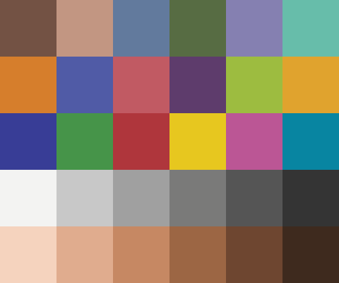
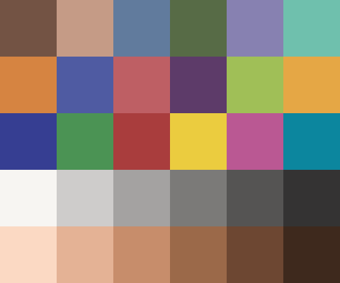
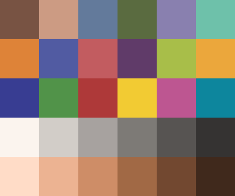
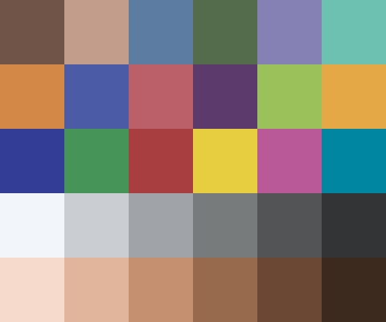
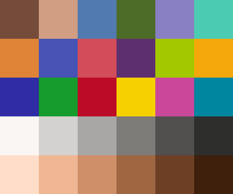
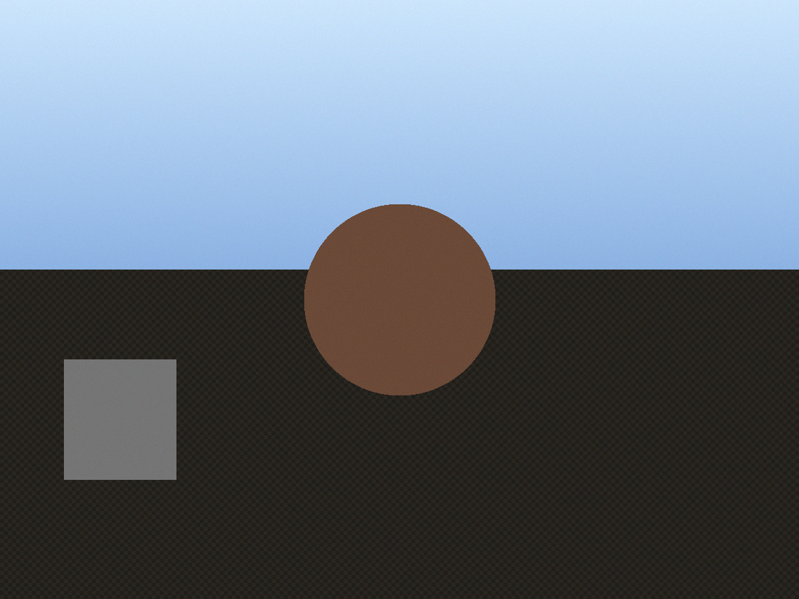
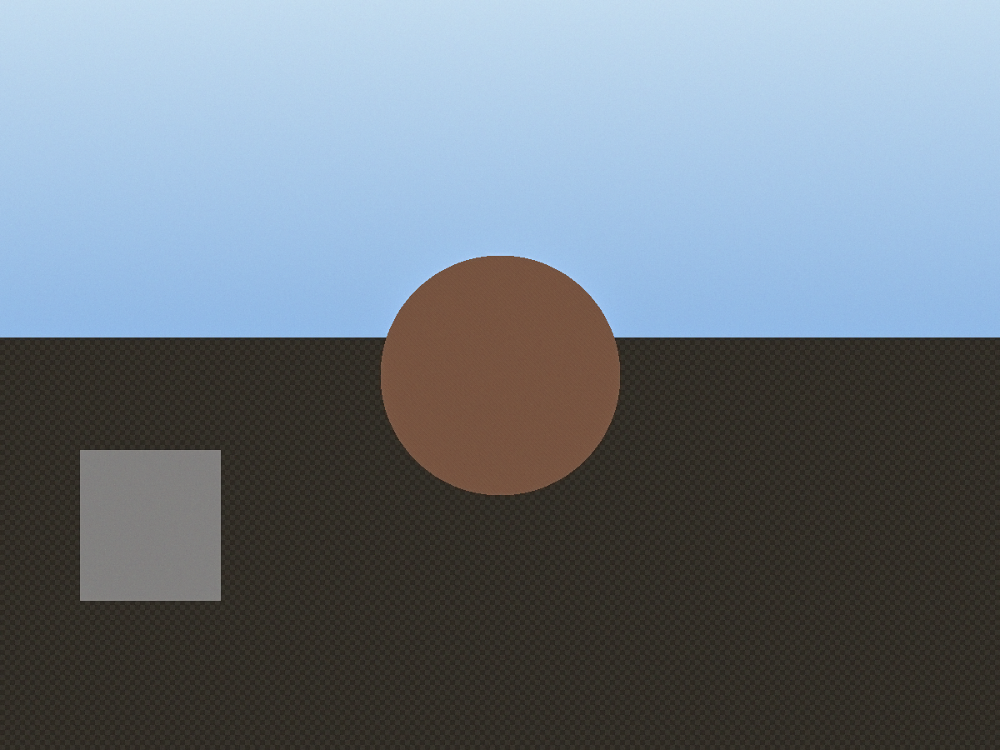
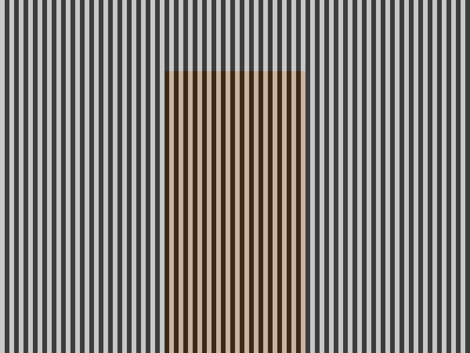
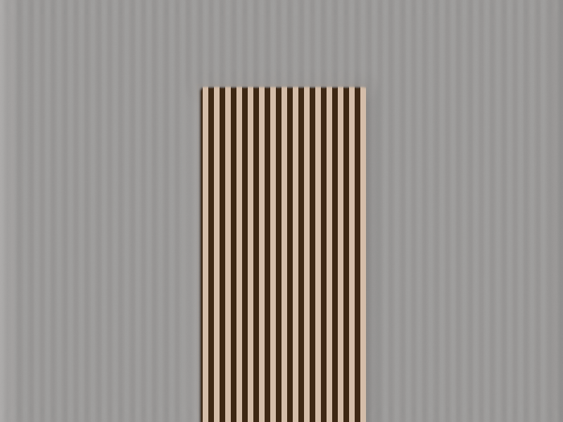
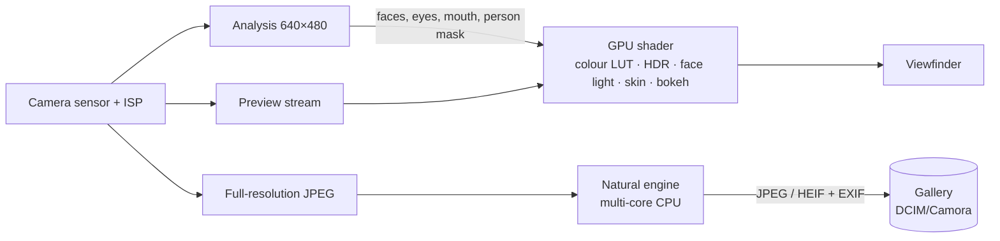

<div align="center">


# Camora

### Natural photos, developed on your phone.

A premium Android camera with its own image engine. Photos come out with true to life colour, soft highlights, balanced faces and real skin texture.

[](#install)
[](https://kotlinlang.org)
[](https://developer.android.com/compose)
[](https://developer.android.com/media/camera/camerax)
[](#privacy)
[](docs/GALAXY_M35.md)

**[Download the APK](../../releases/latest)** · [How it works](docs/ARCHITECTURE.md) · [Galaxy M35 notes](docs/GALAXY_M35.md)

</div>

---

## ✨ Why Camora

Most phone cameras push saturation, sharpening and beauty filters. Camora goes the other way. Inspired by the gentle look of the iPhone 11 and 12, it develops every photo with its own **Natural image engine**:

- 🎨 **Natural colour science.** Colour profiles are evaluated in the perceptual OKLab space, so skin stays golden, skies stay blue and foliage never turns neon.
- 🌗 **Smart HDR.** Edge-aware local tone mapping recovers shadows and highlights without the flat "HDR look". HDR On merges a 3-frame burst.
- 🙂 **Faces done right.** Exposure follows faces, and a backlit face is lifted based on the *lighting*, never by lightening skin tone.
- 🪞 **What you see is what you get.** The viewfinder runs the same pipeline on the GPU: colour profile, HDR, face lighting, skin smoothing and portrait blur, all **in real time**.
- 🔒 **Private by design.** Camora has no internet permission. Everything happens on the phone.

## 📸 Features

| | |
|---|---|
| **Modes** | Portrait · Photo · Selfie · Pro. Swipe the viewfinder to switch |
| **Colour profiles** | Original, **Natural**, Warm, Cool, Vivid, with an intensity slider and a live preview |
| **HDR** | Auto (adaptive local tone mapping) · On (3-frame burst, ghost-free merge) · Off |
| **Skin** | Smoothing, even tone and face lighting, previewed live on faces only. Pores, eyes, brows and lips always stay sharp |
| **Portrait** | Person segmentation, refined hair edges, lens-like disc blur with bokeh highlights, f/1.4 to f/16 |
| **Pro** | ISO, shutter, white balance, manual focus, exposure and a live histogram. Each control appears only if the camera supports it |
| **Viewfinder** | Tap to focus, drag for exposure, long press for AE/AF lock, pinch zoom, .6 / 1 / 2 / 4 zoom, grid, timer, flash, selfie screen flash, volume key shutter |
| **Gallery** | Built-in grid and viewer with Share, Details (EXIF and what the engine did), Delete and **Edit** |
| **Editor** | Exposure, contrast, highlights, shadows, saturation, warmth, tint, sharpness, look, HDR, skin, rotate and crop. Saves as a copy |
| **Formats** | JPEG (EXIF kept) or HEIF |
| **Design** | Material 3 with light and dark themes and dynamic colour. Adapts to any screen size |

## 🎨 The looks

Colour chart (ColorChecker patches, a skin tone row and a grey ramp) rendered by the engine:

| Original | Natural | Warm | Cool | Vivid |
|:---:|:---:|:---:|:---:|:---:|
|  |  |  |  |  |

Engine test scenes. On the left, a backlit face is lifted while the sky keeps its colour; on the right, the portrait background is blurred while the subject stays sharp:

| Backlit: before | Backlit: after | Portrait: before | Portrait: after |
|:---:|:---:|:---:|:---:|
|  |  |  |  |

## 🧠 How it works



The preview and the photo share **the same decisions and the same 33³ colour LUT**. A WebGL test renders a colour chart through the live shader, and it matches the CPU engine within 1/255. Full details are in [docs/ARCHITECTURE.md](docs/ARCHITECTURE.md).

**Tech stack:** Kotlin · Jetpack Compose · Material 3 · CameraX + Camera2 interop · OpenGL ES 3.0 · ML Kit (bundled, on-device) · DataStore · MediaStore.

## 📲 Install

1. Download `Camora-2.1.3.apk` from **[Releases](../../releases/latest)**.
2. Open it on your phone and allow *Install unknown apps* when asked.
3. Grant the camera permission. That's the only one Camora asks for.

## 🛠 Build from source

Requirements: **JDK 17** and **Android SDK 35**. Android Studio Ladybug or newer works.

```bash
git clone https://github.com/tamimrijan/Camora.git
cd Camora
./gradlew assembleRelease          # Windows: gradlew.bat assembleRelease
```
The APK is written to `app/build/outputs/apk/release/`. Use the release build on a phone; debug builds run the image engine several times slower.

To run the engine unit tests (they also render the sample images above):
```bash
./gradlew :app:testDebugUnitTest
```

## 📁 Project structure

```
app/src/main/java/com/tamimrijan/camora/
├── engine/      Natural image engine (pure Kotlin, unit-tested on the JVM)
├── gl/          OpenGL ES live preview (CameraX SurfaceProcessor + shaders)
├── camera/      CameraX + Camera2 controller, live ML Kit analysis, capability probing
├── processing/  Decode · orient · encode · EXIF, background photo pipeline
├── data/        Settings (DataStore) and MediaStore repository
└── ui/          Compose screens: camera, gallery, editor, tabbed settings
```

## 🔒 Privacy

- The only permission is the **camera**.
- The **internet permission is removed** from the app, so photos, faces and usage data cannot leave the device.
- Face detection and segmentation use ML Kit models bundled in the app, running offline.
- Photos are saved locally to `DCIM/Camora`.

## 👤 Author

<table>
<tr>
<td align="center">
<b>Tamim Ahmed Rijan</b><br/>
Designer & developer of Camora<br/><br/>
<a href="https://github.com/tamimrijan"></a>
<a href="https://www.instagram.com/tamim_ahmed_rijan/"></a>
</td>
</tr>
</table>

If you like Camora, leave a ⭐ on the repository!

---

<div align="center">
<sub>© 2026 Tamim Ahmed Rijan. Made with care for natural photography.</sub>
</div>
